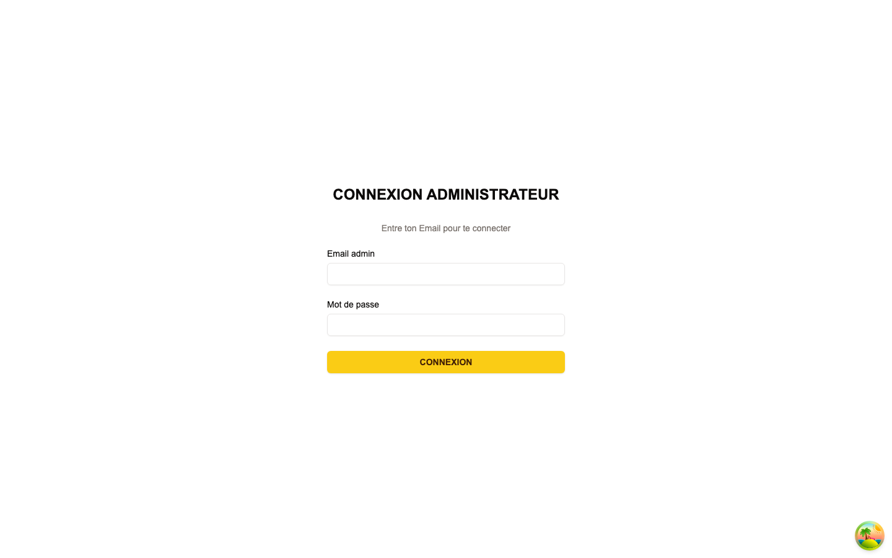
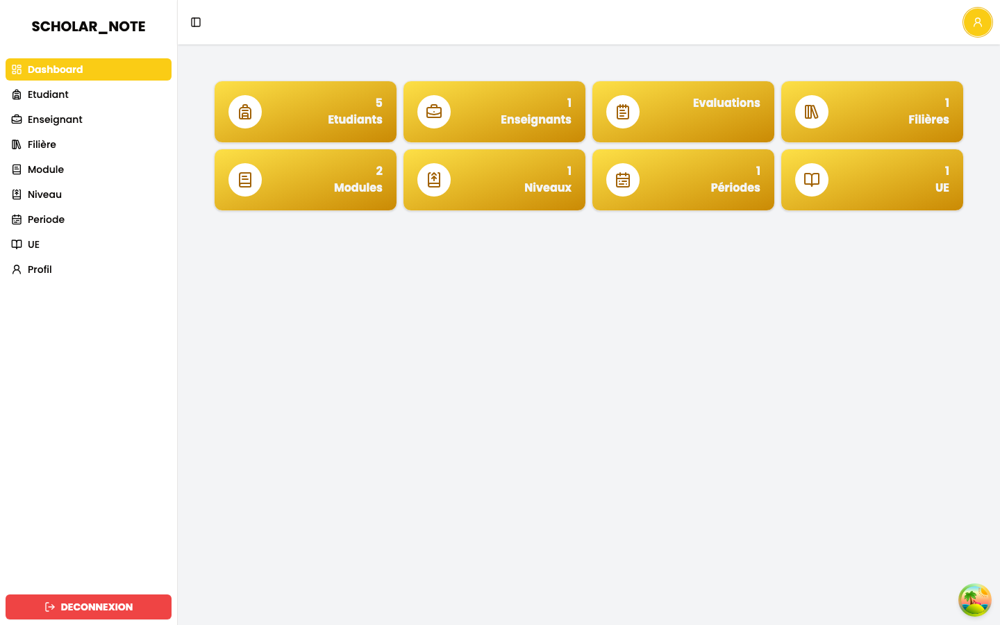
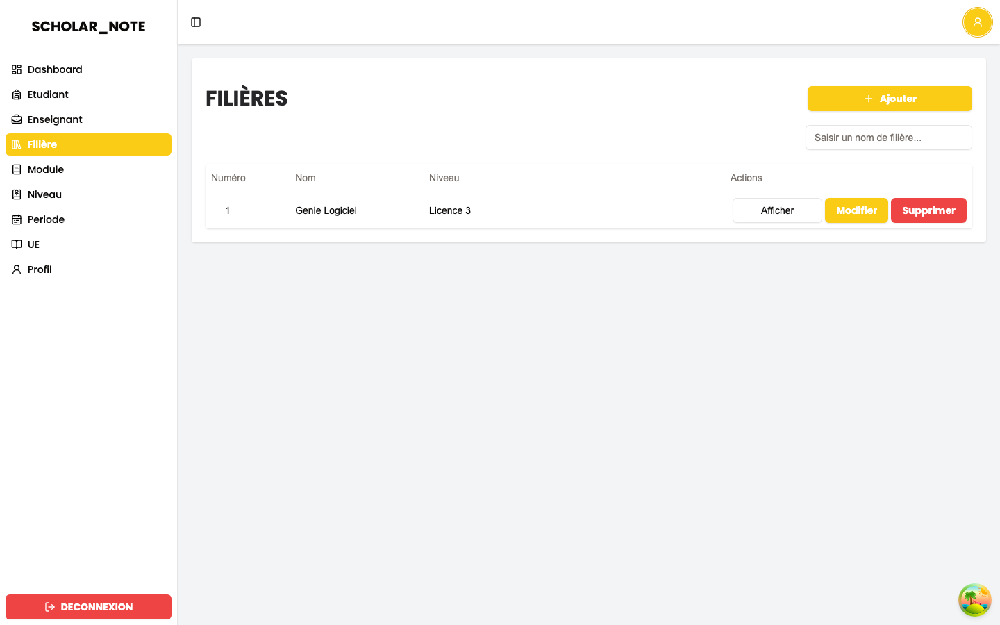
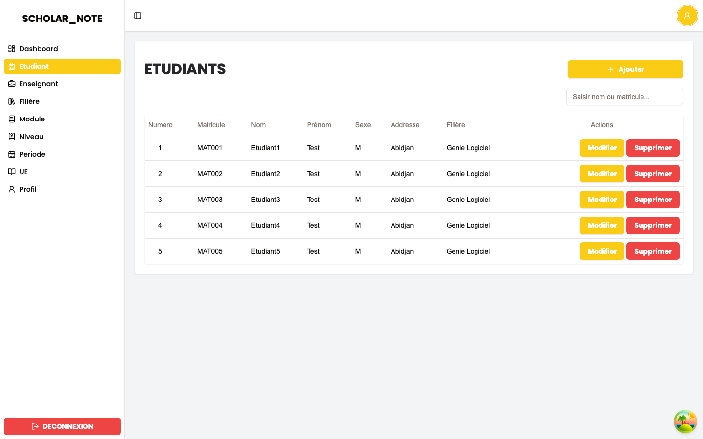
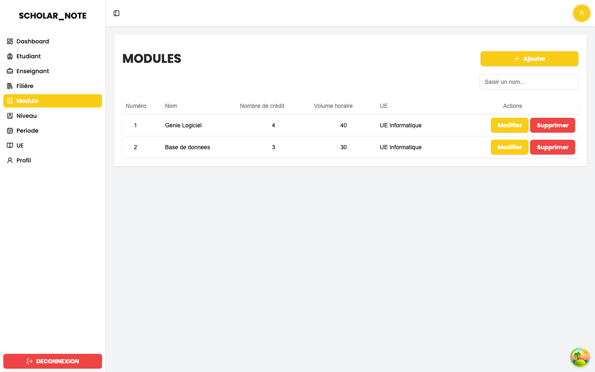
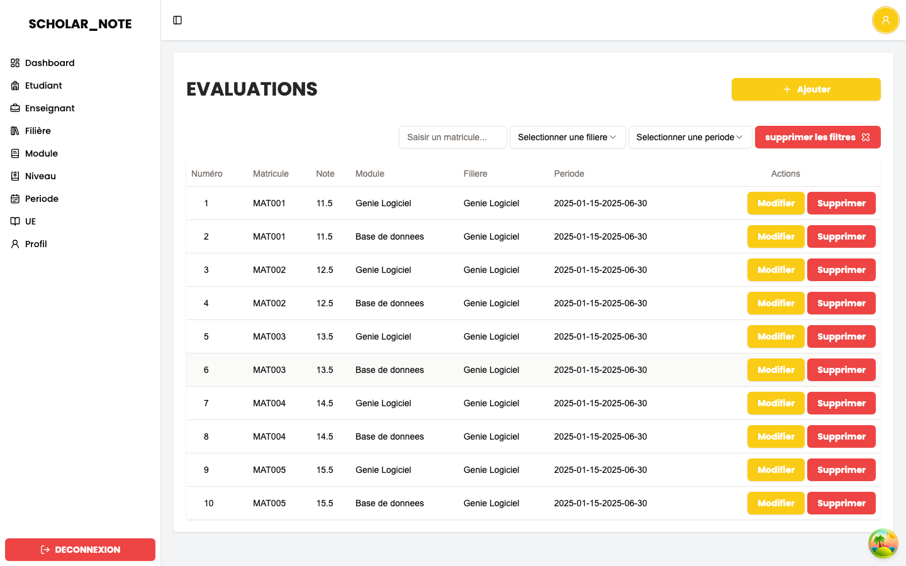

# Scholar Note

Application de gestion des notes (filières, niveaux, UE, modules, évaluations, notes, bulletins).

> 🎓 **Projet réalisé dans le cadre de mon cours de Génie Logiciel.**

## Structure du dépôt

| Dossier | Contenu | Stack |
|---|---|---|
| [`frontend/`](frontend) | Interface web | Next.js, TypeScript, Tailwind CSS |
| [`backend/`](backend) | API REST | FastAPI, SQLAlchemy, Alembic |

## Fonctionnalités

- Authentification et gestion des utilisateurs (administrateur, enseignant, étudiant)
- Gestion des filières, niveaux, périodes, UE et modules
- Création d'évaluations et saisie des notes
- Génération des bulletins

Les tables sont créées automatiquement au démarrage du backend.

## Captures d'écran

| Connexion | Tableau de bord |
|---|---|
|  |  |
|  |  |
|  |  |

## Lancer le projet

### Backend

```bash
cd backend
python -m venv venv && source venv/bin/activate
pip install -r requirements.txt
cp .env.example .env   # SQLite par défaut ; DATABASE_URL pour PostgreSQL
uvicorn Main:app --reload
```

### Frontend

```bash
cd frontend
cp .env.example .env.local   # NEXT_PUBLIC_API_URL = URL du backend
npm install
npm run dev
```

Ouvrir [http://localhost:3000](http://localhost:3000).
